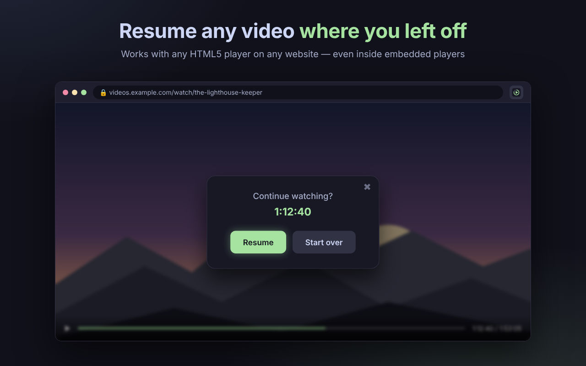
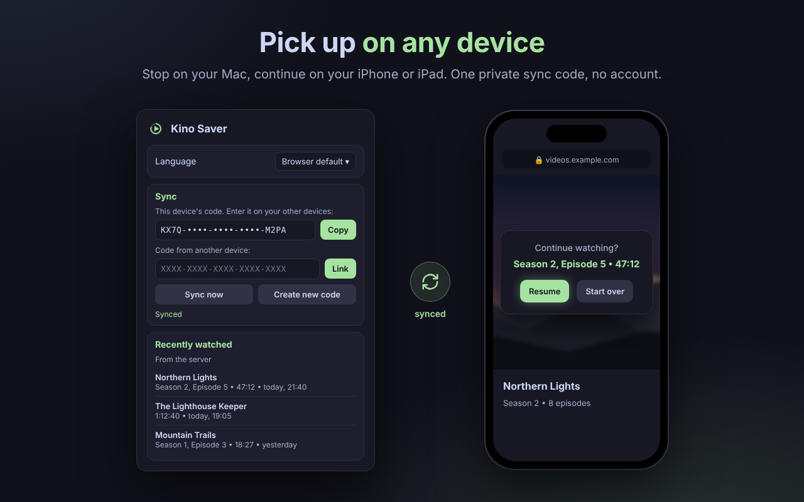
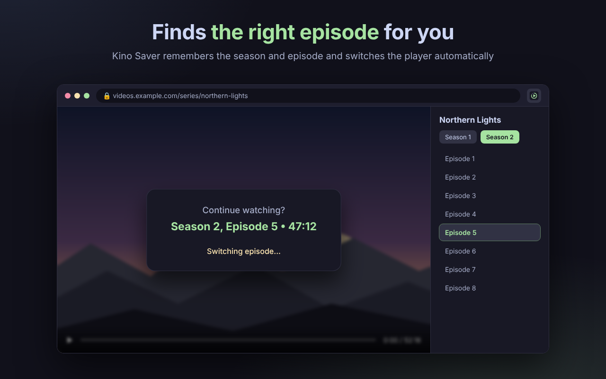
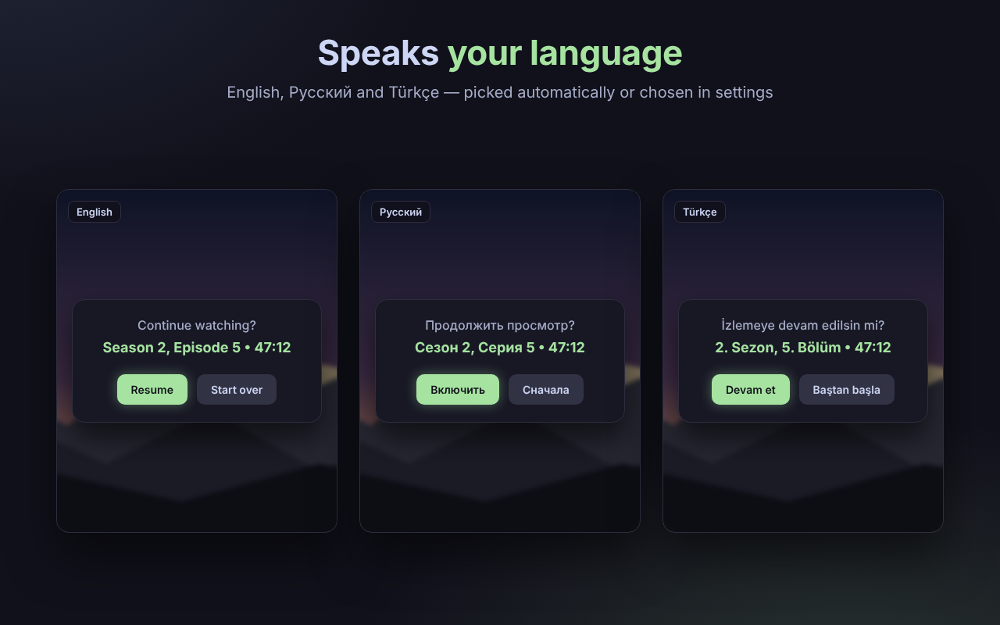

# Kino Saver

**Resume any video where you left off — on any of your devices.**

<!-- After the store approval, replace this badge with:

-->

[English](README.md) · [Русский](README.ru.md) · [Türkçe](README.tr.md)

 

## Why Kino Saver

You stop a film halfway, close the laptop and come back two days later — on a different device. Kino Saver remembers the exact second, the season and the episode, and offers to continue right there.

## Features

- 🎬 **Works on any website** with an HTML5 video player, including players embedded in other sites.
- 📺 **Seasons and episodes** — remembers where you are in a series and switches to the right episode for you.
- 🔄 **Sync between devices** — continue on your Mac, iPhone or iPad with one private sync code. No account, no email, no password.
- 🧹 **Smart** — skips ads and trailers and does not offer to resume videos you have finished.
- 📴 **Works offline** — progress is always saved on your device first.
- 🌍 **Three languages** — English, Russian and Turkish.

## Screenshots

 

## How to use

1. **Install** Kino Saver from the Chrome Web Store.
2. **Watch** a video as usual — progress is saved automatically.
3. **Come back** to the same page — Kino Saver asks *"Continue watching?"*. Click **Resume**.

**To sync your devices:** click the Kino Saver icon on your first device, copy the sync code and enter it in Kino Saver on your other devices.

## Supported browsers

| Browser | Status |
|---|---|
| Google Chrome (macOS, Windows, Linux) | ✅ Supported |
| Orion (macOS, iPhone, iPad) | 🧪 In testing |

## Privacy

Kino Saver stores only the playback position, season/episode, page title and update time. The page address is synced only as a one-way hash. Data is never sold or shared. Read the full [Privacy Policy](PRIVACY.md).

## FAQ

**Is it free?** Yes.

**Does it work on every website?** It works on any site with a standard HTML5 video player. Some players built with custom technology may not be supported.

**Do I need an account?** No. Devices are linked with a randomly generated sync code.

**How do I delete my data?** Removing the extension deletes all local data. To stop syncing, create a new sync code in the extension window.

## Feedback

- ⭐ Liked it? **Rate Kino Saver and leave a review in the Chrome Web Store** — it helps a lot.
- 🐞 Found a bug or have an idea? Open an [issue](../../issues).

---

© 2026 Kino Saver. All rights reserved.

