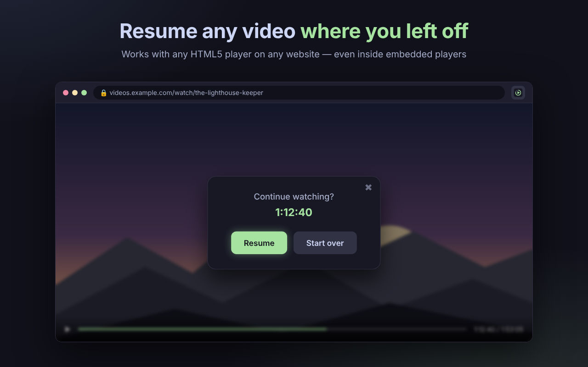

# Kino Saver

**Продолжайте любое видео с того места, где остановились, — на любом своем устройстве.**

<!-- После одобрения в магазине замените плашку на:

-->

[English](README.md) · [Русский](README.ru.md) · [Türkçe](README.tr.md)

 

## Зачем Kino Saver

Вы остановили фильм на середине, закрыли ноутбук и вернулись через два дня — уже на другом устройстве. Kino Saver помнит точную секунду, сезон и серию и предлагает продолжить с этого места.

## Возможности

- 🎬 **Работает на любом сайте** с HTML5-плеером, в том числе со встроенными плеерами.
- 📺 **Сезоны и серии** — помнит, где вы остановились в сериале, и сам переключает на нужную серию.
- 🔄 **Синхронизация между устройствами** — продолжайте на Mac, iPhone или iPad по одному личному коду. Без аккаунта, email и пароля.
- 🧹 **Умный** — пропускает рекламу и трейлеры и не предлагает продолжить досмотренное.
- 📴 **Работает без интернета** — прогресс всегда сначала сохраняется на устройстве.
- 🌍 **Три языка** — русский, английский и турецкий.

## Как пользоваться

1. **Установите** Kino Saver из Chrome Web Store.
2. **Смотрите** видео как обычно — прогресс сохраняется сам.
3. **Вернитесь** на ту же страницу — Kino Saver спросит «Продолжить просмотр?». Нажмите **Включить**.

**Синхронизация устройств:** нажмите на иконку Kino Saver на первом устройстве, скопируйте код и введите его в Kino Saver на остальных устройствах.

## Браузеры

| Браузер | Статус |
|---|---|
| Google Chrome (macOS, Windows, Linux) | ✅ Поддерживается |
| Orion (macOS, iPhone, iPad) | 🧪 Тестируется |

## Конфиденциальность

Kino Saver хранит только позицию просмотра, сезон и серию, название страницы и время изменения. Адрес страницы синхронизируется только в виде хэша. Данные не продаются и не передаются третьим лицам. Подробнее — в [политике конфиденциальности](PRIVACY.md).

## Обратная связь

- ⭐ Понравилось? **Поставьте оценку и оставьте отзыв в Chrome Web Store** — это очень помогает.
- 🐞 Нашли ошибку или есть идея? Создайте [issue](../../issues).

---

© 2026 Kino Saver. Все права защищены.

