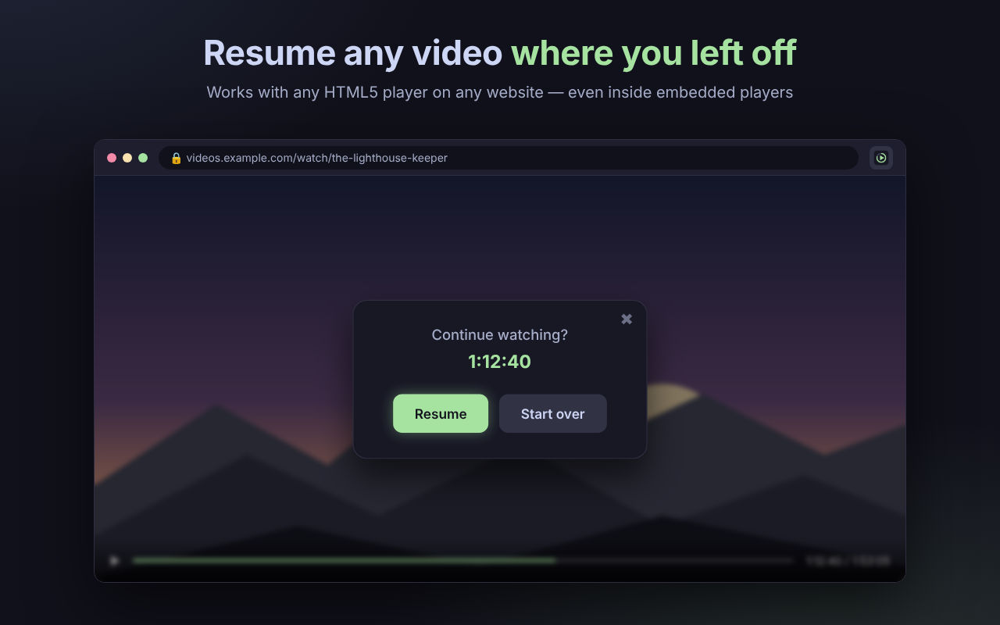

# Kino Saver

**Herhangi bir videoya kaldığınız yerden devam edin — tüm cihazlarınızda.**

<!-- Mağaza onayından sonra rozeti şununla değiştirin:

-->

[English](README.md) · [Русский](README.ru.md) · [Türkçe](README.tr.md)

 

## Özellikler

- 🎬 **Her sitede çalışır** — gömülü oynatıcılar dahil her HTML5 video oynatıcıyla.
- 📺 **Sezonlar ve bölümler** — dizide nerede kaldığınızı hatırlar ve doğru bölüme kendisi geçer.
- 🔄 **Cihazlar arası senkronizasyon** — Mac, iPhone veya iPad'de tek bir kişisel kodla devam edin. Hesap, e-posta veya şifre gerekmez.
- 🧹 **Akıllı** — reklamları ve fragmanları atlar, bitirdiğiniz videolar için devam etmeyi önermez.
- 📴 **İnternetsiz çalışır** — ilerleme her zaman önce cihazınıza kaydedilir.
- 🌍 **Üç dil** — Türkçe, İngilizce ve Rusça.

## Nasıl kullanılır

1. Kino Saver'ı Chrome Web Store'dan **yükleyin**.
2. Videoyu her zamanki gibi **izleyin** — ilerleme otomatik kaydedilir.
3. Aynı sayfaya **geri dönün** — Kino Saver "İzlemeye devam edilsin mi?" diye sorar. **Devam et**'e tıklayın.

**Cihazları senkronize etmek için:** ilk cihazda Kino Saver simgesine tıklayın, kodu kopyalayın ve diğer cihazlarınızda Kino Saver'a girin.

## Gizlilik

Kino Saver yalnızca izleme konumunu, sezon/bölümü, sayfa başlığını ve güncelleme zamanını saklar. Sayfa adresi yalnızca tek yönlü bir özet (hash) olarak senkronize edilir. Veriler satılmaz ve paylaşılmaz. Ayrıntılar: [Gizlilik Politikası](PRIVACY.md) (İngilizce).

## Geri bildirim

- ⭐ Beğendiniz mi? **Chrome Web Store'da puan verin ve yorum bırakın** — çok yardımcı olur.
- 🐞 Hata mı buldunuz ya da bir fikriniz mi var? Bir [issue](../../issues) açın.

---

© 2026 Kino Saver. Tüm hakları saklıdır.

